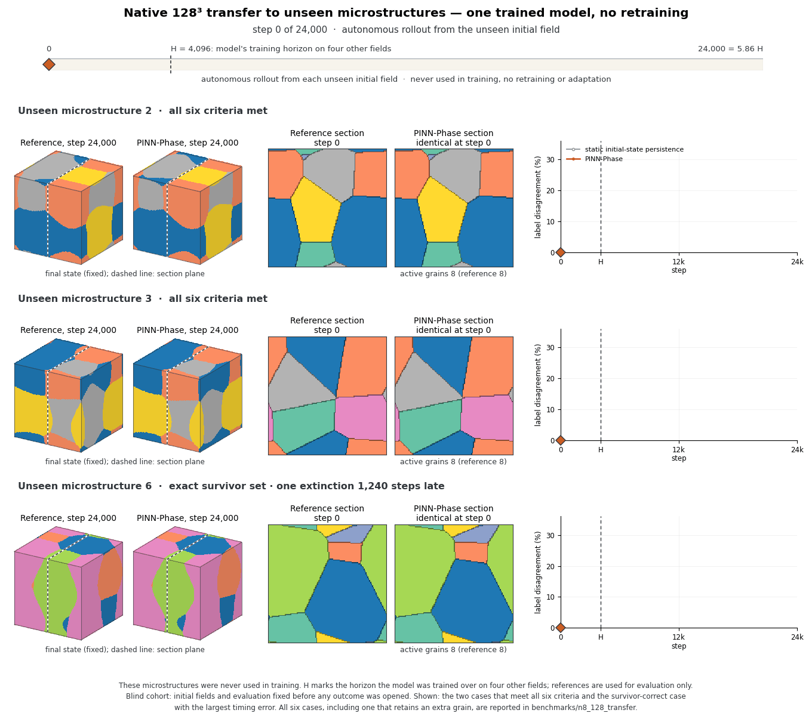
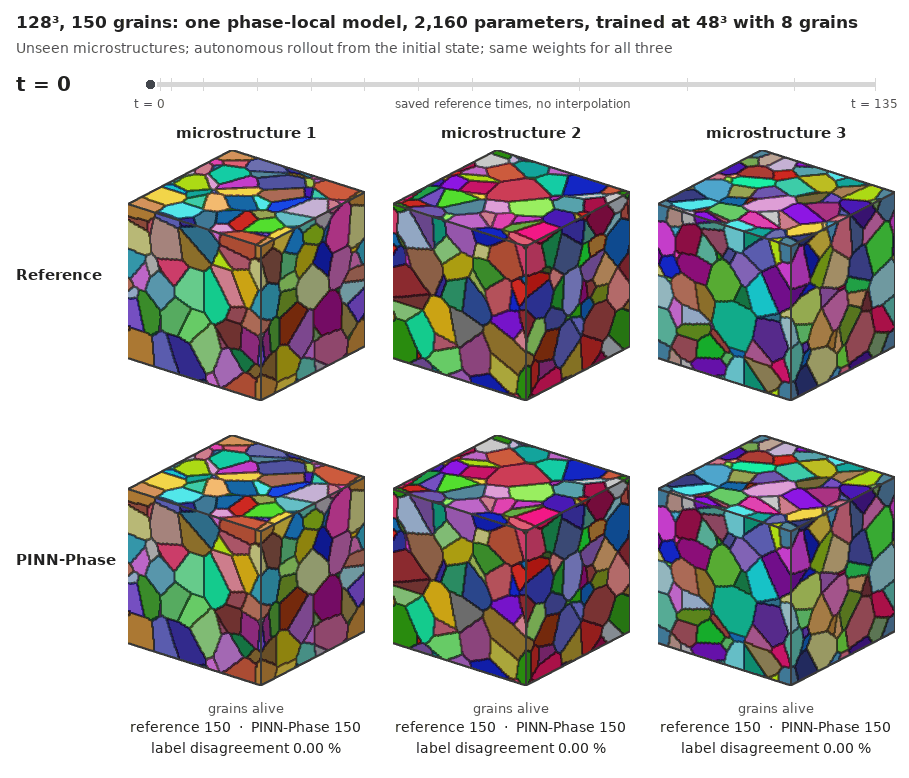
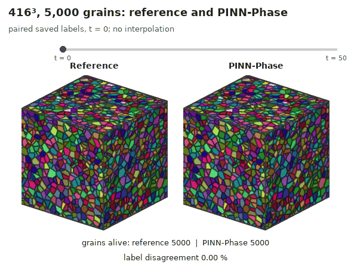
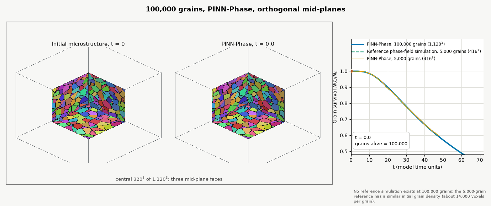

# PINN-Phase

**Physics-informed neural time integration for curvature-driven phase-field evolution.**

PINN-Phase advances phase fields through autonomous neural updates while preserving an admissible multiphase state. The tested runs cover two- and three-dimensional coarsening, topology change, unseen initial conditions, and populations up to 100,000 grains, verified grain by grain up to 5,000. The repository provides replay weights, compact score records, verification tools, and a technical report that states the scope of each result.

<p align="center">
  
</p>

*A PINN-Phase update predicts a bounded phase increment, advances the field, and returns an admissible state for the next step.*

## What PINN-Phase does

PINN-Phase learns a time-integration rule from physical targets evaluated on its own evolving states. Each prediction becomes the next input, with no reference states after the initial condition. A bounded update and an admissibility map keep phase fractions in [0, 1] with unit sum at every point. The physical operator provides targets during training but is not called during an autonomous step. The [technical report](docs/TECHNICAL_REPORT.md#model-families-and-reproduction-levels) describes the model families, training paths, evaluation measures, reproduction levels, and limitations for each study.

## Formulation in brief

**State.** A polycrystal is an $N$-phase diffuse field $\boldsymbol{\varphi}=(\varphi_1,\ldots,\varphi_N)$ on a periodic grid. It is admissible when every phase fraction lies in $[0,1]$ and the fractions sum to one at every point:

$$
\mathcal{A}_N=\Big\lbrace \boldsymbol{\varphi}\in[0,1]^N : \sum_{k=1}^{N}\varphi_k=1 \Big\rbrace .
$$

**Physics.** Grain boundaries move by curvature. The hybrid realization learns from the projected multiphase Allen-Cahn rate, with mobility $\mu$, interfacial energy scale $\sigma$, interface width $\eta$, double-well $W(\varphi)=\varphi^2(1-\varphi)^2$ and the zero-sum projection $\mathcal{P}_N(\mathbf{v})_k=v_k-\frac{1}{N}\sum_j v_j$:

$$
\frac{\partial \boldsymbol{\varphi}}{\partial t}=\mathbf{R}(\boldsymbol{\varphi})=\mu\sigma\,\mathcal{P}_N\Big[\nabla^2\boldsymbol{\varphi}-\frac{1}{\eta^2}W'(\boldsymbol{\varphi})\Big].
$$

The phase-local realization learns from one step of a projected obstacle-type map, with $\Pi_\Sigma$ the exact projection onto the phase-fraction simplex:

$$
\mathcal{T}(\boldsymbol{\varphi})=\Pi_\Sigma\Big[\boldsymbol{\varphi}+\Delta t\,\big(\kappa\,\nabla_h^2\boldsymbol{\varphi}+\beta\,\boldsymbol{\varphi}\big)\Big].
$$

**Neural time step.** Both realizations advance the field by a learned increment followed by a map back to admissible states:

$$
\boldsymbol{\varphi}_{t+1}=\mathcal{A}\big(\boldsymbol{\varphi}_t,\;\boldsymbol{\varphi}_t+\Delta_\theta(\boldsymbol{\varphi}_t)\big).
$$

In the hybrid realization, $\Delta_\theta=\Delta\varphi_{\max}\,\mathcal{P}_N[\tanh(\mathbf{z}_t)]$ blends a site-local and a convolutional-recurrent response, and $\mathcal{A}$ clips to $[0,1]$ and renormalizes. In the phase-local realization, one shared 2,160-parameter convolutional rule acts on each phase separately, so the weights do not depend on the number of grains, and $\mathcal{A}$ is the exact simplex projection.

**Training on its own states.** The physical target is evaluated on the states the model itself produces, never on a precomputed reference trajectory. For the phase-local realization, with $\mathcal{U}_\theta$ the learned step and $\mathrm{sg}$ a stop-gradient:

$$
\mathcal{L}(\theta)=\Big\langle \big\lVert\, \mathcal{U}_\theta(\boldsymbol{\varphi})-\mathrm{sg}\big(\mathcal{T}(\boldsymbol{\varphi})\big)\big\rVert^2 \Big\rangle_{\boldsymbol{\varphi}\,\in\,\text{model rollouts}} .
$$

The hybrid loss compares the bounded increment with $\Delta t\,\mathbf{R}(\boldsymbol{\varphi}_t)$ on the predicted field in the same way. Full definitions, parameter values and the remaining loss terms are in the [technical report](docs/TECHNICAL_REPORT.md) and the paper.

## Highlights

| Tested runs | Decisive result |
|---|---|
| 25-grain development cascade, one initial condition to 12,000 steps | Exact 16-grain terminal survivor set |
| Dense 64-grain sensitivity run, one initial condition to 12,000 steps | 43 of 43 reference extinctions matched by identity |
| Prospective 25-grain transfer, eight unseen and two harder cases | All criteria met in 7 of 8 unseen and 2 of 2 harder cases |
| Native 128³, six development and six blind unseen initial conditions to 24,000 steps | Exact terminal survivor sets in 6 of 6 development and 5 of 6 blind cases; all six criteria in 4 of 6 and 2 of 6 |
| Phase-local 128³ tests, three unseen 150-grain microstructures to t = 135 | All 368 reference extinctions matched by identity |
| Grain-level population tests with 1,000 and 5,000 grains | 5,449 of 5,450 reference extinctions matched by identity within tolerance; one event straddles the horizon |
| Reference-free population test, one 1,120³ microstructure with 100,000 initial grains | Fraction of surviving grains within 0.009 of the 5,000-grain reference simulation through t = 72.08; 41,104 grains survive at t = 72.08 |

Each row is scoped to the named runs; criteria, horizons, and limitations are in the [technical report](docs/TECHNICAL_REPORT.md).

## Selected results

### Two-dimensional coarsening

<p align="center">
  
</p>

*In this tested development run, 25 grains reach the exact 16-grain reference survivor set through 12,000 steps. Terminal label disagreement is 1.46%, but the extinction-timing criterion is not met; see the [25-grain report section](docs/TECHNICAL_REPORT.md#the-25-grain-cascade).*

### Prospective transfer in two dimensions

<p align="center">
  
</p>

*Across the tested cohort, 7 of 8 unseen cases and 2 of 2 harder cases meet every criterion. This representative case has the same 13 terminal grains as its reference and 1.38% label disagreement; see the [prospective-transfer report section](docs/TECHNICAL_REPORT.md#prospective-generalization-to-unseen-initial-conditions).*

### Native 128³ evolution

<p align="center">
  
</p>

*Through 24,000 steps, terminal survivor sets are exact in 6 of 6 development and 5 of 6 blind cases. All six criteria are met in 4 of 6 and 2 of 6; see the [native 128³ report section](docs/TECHNICAL_REPORT.md#native-128%C2%B3-one-model-four-training-fields-twelve-unseen-initial-conditions).*

### Phase-local scaling

<p align="center">
  
</p>

*Across three tested 150-grain microstructures, all 368 reference extinctions match by identity. The volume criterion holds through t = 80 for all three, but later errors exceed 0.05 in two; see the [phase-local report section](docs/TECHNICAL_REPORT.md#phase-local-one-2160-parameter-model-across-domain-sizes-and-grain-counts).*

### Population size

<p align="center">
  
</p>

*For the single tested 5,000-grain run through t = 75, all 3,018 reference extinctions match by identity within tolerance. The animation shows the paired states through t = 50; see the [population-size report section](docs/TECHNICAL_REPORT.md#population-size-with-phase-channels) for the continuation and error bounds.*

<p align="center">
  
</p>

*This reference-free animation places the initial state beside the evolving state. Over the common range with the 5,000-grain reference, the maximum absolute N(t)/N0 difference is 0.00865; see the [population-size report section](docs/TECHNICAL_REPORT.md#population-size-with-phase-channels).*

The [media gallery](docs/MEDIA_GALLERY.md) indexes the complete visual record, including companion cases omitted from this shorter results sequence.

## Quick start

Use Python 3.11 with PyTorch 2.6 or newer for this compact replay, and see [Using this archive](docs/USING_THIS_ARCHIVE.md) for model replay, score recomputation, and study-specific requirements.

```bash
conda env create -f environment-cpu.yml
conda activate pinn-phase-cpu
python scripts/reproduce_scalar_reference.py
```

## Verify this archive

From a fresh extraction, run `python -m pytest -q`, `python scripts/verify_manifest.py`, and `python scripts/smoke_test.py`. Together they exercise the public tests, verify payload identities, and check physics, admissibility, and equivariance. The [full verification procedure](docs/USING_THIS_ARCHIVE.md) explains each command, its expected output, and the available reproduction levels.

## Repository map

| Path | Contents |
|---|---|
| `src/pinn_phase/` | Models, physics, training, evaluation, and safe input/output |
| `benchmarks/` | Shipped benchmark records and initial conditions |
| `checkpoints/` | Replay weights, lineage records, and checksums |
| `scripts/` | Replay, score verification, rendering, and archive checks |
| `docs/` | Method, tutorials, evidence records, and reproduction guidance |
| `media/` | Figures and animations bound to the archive manifest |

## Predecessor work

PINN-Phase follows our earlier **PINNs-MPF** framework, which approaches
multi-phase-field evolution through physics-informed space-time decomposition
and coordinated neural networks. PINN-Phase instead develops the autonomous
autoregressive time-integrator formulation studied here.

**[PINNs-MPF repository](https://github.com/SFETNI/PINNs_MPF--a-Physics-Informed-Neural-Network-for-Multi-Phase-Field-problems)**

## Paper and citation

**PINN-Phase: Physics-informed neural integration for accurate, generalizable, and scalable multiphase-field evolution**  
S. Elfetni, S. Thinius, P. H. Seeberger, and T. Tyrikos-Ergas  
[arXiv:2608.29413](https://arxiv.org/abs/2608.29413) | [DOI: 10.48550/arXiv.2608.29413](https://doi.org/10.48550/arXiv.2608.29413)

Software citation metadata is provided in [`CITATION.cff`](CITATION.cff).

## License

Code is available under the BSD-3-Clause license. Distributed data and media use CC BY 4.0 unless a file-specific manifest states otherwise. See [`ASSET_LICENSE.md`](ASSET_LICENSE.md).

Full technical report: [docs/TECHNICAL_REPORT.md](docs/TECHNICAL_REPORT.md)
